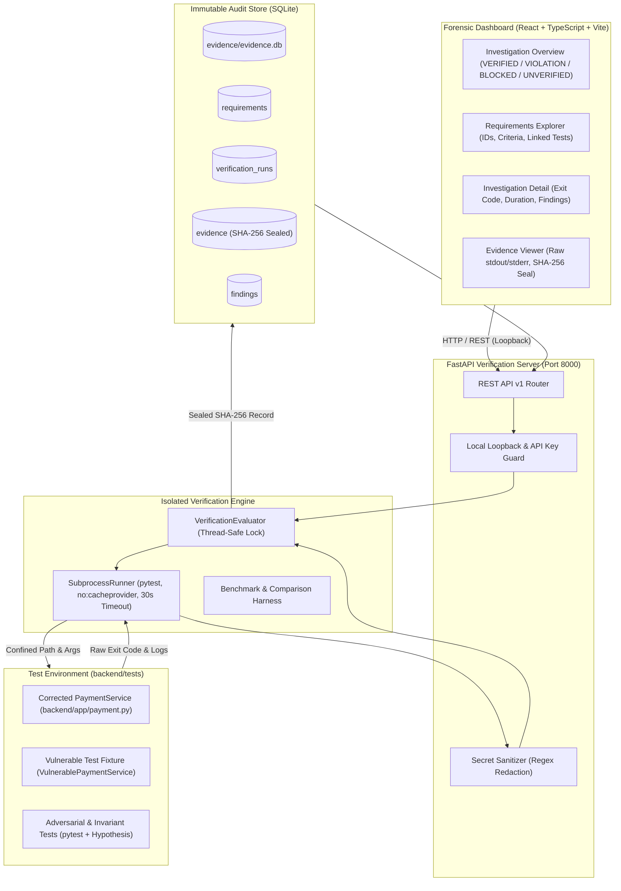

# GHOST PROTOCOL

> **Product Slogan**: *"AI says Done. We demand proof."*  
> **Mission**: Build an independent, zero-trust verification tool that checks whether software requirements are satisfied by reproducible, executable evidence rather than trusting an AI coding agent's completion claim.

---

## 1. Problem & Solution

### The Core Problem
Autonomous AI coding agents (Claude Engineer, Cursor Composer, Devin, Copilot Workspace, etc.) frequently report:
> *"I have implemented the feature and all tests passed. Task complete!"*

In reality, agents often write superficial, "happy-path" unit tests that assert trivial inputs while ignoring boundary conditions, race conditions, atomic rollback, and adversarial exploits. When untested code enters production, financial transactions corrupt balances, permissions leak, and invariant conservation fails.

### The Ghost Protocol Solution
Ghost Protocol serves as an independent evidence engine and forensic verification gateway:
1. **Catalog Registry**: Formal requirements paired with explicit acceptance criteria.
2. **Adversarial & Property Harness**: Tests boundary conditions, overdraft attempts, and conservation invariants rather than trusting mocked happy paths.
3. **Isolated Execution Subprocess**: Runs tests under strict isolation (no arbitrary shell commands, 64KB output limits, flag injection prevention, 30s timeouts).
4. **Cryptographic Evidence Sealing**: Captures raw exit codes, stdout/stderr streams, and code/test SHA-256 fingerprints, sealing each run in an immutable SQLite audit ledger.
5. **Zero-Trust State Machine**: A requirement transitions to `VERIFIED` **only** if 100% of its acceptance criteria have passing test evidence. Gaps remain strictly `UNVERIFIED`. Violations trigger actionable findings with deterministic reproduction commands.

---

## 2. System Architecture & Evidence Provenance

### High-Level Architecture



### Evidence Provenance & Cryptographic Verification
Every verification run produces a verifiable chain of custody:
1. **Target Source Fingerprint**: SHA-256 hash of `backend/app/payment.py` at runtime.
2. **Test Suite Fingerprint**: SHA-256 hash of the specific test file executed.
3. **Execution Metadata**: Subprocess command line, exact start/end ISO-8601 UTC timestamps, exit code, and wall-clock duration.
4. **Payload Digest**: SHA-256 hash computed across sanitized stdout and stderr.
5. **Tamper Verification**: The endpoint `GET /api/v1/evidence/{evidence_id}/verify` recomputes the payload digest on demand and verifies it against the sealed record in `verification_runs`.

---

## 3. Four-State Zero-Trust State Machine

| Status | Definition | Exit Code | Finding Generated? |
| :--- | :--- | :--- | :--- |
| `VERIFIED` | 100% of acceptance criteria have passing test evidence. | Exit Code `0` | No |
| `VIOLATION` | Executed test proves a requirement failure or contract breach. | Exit Code `1` | Yes (`CRITICAL` / `HIGH`) |
| `BLOCKED` | Environment crash, syntax error, missing dependency, or timeout. | Exit Code `2`, `3`, `4`, or Timeout | Yes (`HIGH` / `BLOCKED`) |
| `UNVERIFIED` | Insufficient evidence; no test bound or criteria lack coverage. | Exit Code `5` (0 tests) or Unbound | No |

> **Non-Negotiable Axiom**: Missing test coverage results in `UNVERIFIED`, never `VERIFIED`. An environment failure is `BLOCKED`, never a feature `VIOLATION`.

---

## 4. Clean Installation & Startup Procedure (Windows)

### Prerequisites
- **Windows 10/11** (PowerShell 5.1 or PowerShell 7+)
- **Python 3.11+ or 3.12+** (accessible as `python` in PATH)
- **Node.js 18+ & npm** (for frontend dashboard)

### Step 1: Clone & Set Up Backend
Open Windows PowerShell:
```powershell
# Navigate to workspace
cd "c:\Users\Abhi\Desktop\kiro hackthon"

# Install backend Python dependencies
pip install -r requirements.txt
```

### Step 2: Install Frontend Dependencies
```powershell
cd frontend
npm install
cd ..
```

### Step 3: Run Full Automated Verification Suite
Ensure all 60 tests pass before launching servers:
```powershell
python -m pytest backend/tests -v
```
*(Expected: 60 passed in ~26 seconds)*

### Step 4: Launch Backend API Server
In PowerShell Terminal 1:
```powershell
python -m uvicorn backend.app.main:app --host 127.0.0.1 --port 8000 --reload
```
API Health Check: [http://127.0.0.1:8000/api/v1/health](http://127.0.0.1:8000/api/v1/health)  
Interactive OpenAPI Docs: [http://127.0.0.1:8000/docs](http://127.0.0.1:8000/docs)

### Step 5: Launch Frontend Forensic Dashboard
In PowerShell Terminal 2:
```powershell
cd frontend
npm run dev
```
Open browser to: [http://localhost:5173](http://localhost:5173)

---

## 5. Three-Minute Live Judging Demonstration Script

> **Full Detailed Script**: See [docs/DEMO_SCRIPT.md](file:///c:/Users/Abhi/Desktop/kiro%20hackthon/docs/DEMO_SCRIPT.md) for speaking points and minute-by-minute cues.

This script walks judges through the primary scenario (`PAYMENT-004`) in exactly 3 minutes.

### Act 1: The AI Agent's False Claim (0:00 – 0:45)
- **Opening Statement**: *"Your AI coding agent says the feature is done. Would you trust it with your money?"*
- **Action**: Direct judges to the AI Agent Completion Claim:
  > *"Agent Claim: Implemented payment transfer. Ran test `test_payment_basics`. 1 passed in 0.02s. Requirement PAYMENT-004 is Done!"*
- **The Catch**: The agent only tested transferring ₹200 from an account with ₹10,000. It never tested transferring ₹15,000.

### Act 2: Exposing the Vulnerable Code (0:45 – 1:30)
- **Action (UI)**: In the Ghost Protocol dashboard, click **"Run Demonstration"** (or in PowerShell run `python scripts/demonstrate_bug.py`).
- **Observable Outcome**:
  - Ghost Protocol executes the adversarial overdraft test against the vulnerable implementation.
  - **Process Exit Code**: `1`
  - **Evaluated Status**: `VIOLATION` (highlighted in crimson).
  - **Terminal Output**: `Failed: DID NOT RAISE InsufficientFundsError`
  - **Defect Discovered**: The vulnerable service debited the sender, pushing the balance negative to -₹5,000!
  - **Finding Generated**: `[CRITICAL]` finding `fnd-1cf69082` created with reproduction instructions:
    ```powershell
    python -m pytest backend/tests/test_adversarial_vulnerable.py -v
    ```

### Act 3: Applying the Fix & Verifying Proof (1:30 – 2:15)
- **Action (UI)**: Click **"Verify Requirement"** on `PAYMENT-004` (testing the corrected implementation in `backend/app/payment.py`).
- **Observable Outcome**:
  - Ghost Protocol runs `backend/tests/test_payment.py::TestPaymentAdversarial::test_overdraft_transfer_rejected_and_balances_unchanged`.
  - **Process Exit Code**: `0`
  - **Evaluated Status**: Transitions to `VERIFIED` (in crisp emerald green).
  - **Evidence Viewer**: Displays exact process logs (`1 passed in 0.03s`), sender balance strictly maintained at ₹10,000, recipient balance at ₹0, and SHA-256 seal verified.

### Act 4: Criteria Coverage & Scientific Benchmark (2:15 – 3:00)
- **Action (UI)**: 
  1. Click on `PAYMENT-003` in the Requirements Explorer.
     - Show that even though its tests pass, `AC-03.4` (audit log stream) has no linked test.
     - **Status**: Strictly stays `UNVERIFIED`. *"No false convergence: unverified criteria cannot be marked verified."*
  2. Click **"Benchmark Report"** on the dashboard.
     - Highlight the 6-defect benchmark:
       - Baseline Happy-Path Tests: **0% defect detection (100% false negative rate)**.
       - Ghost Protocol Adversarial Engine: **100% defect detection (6/6 defects caught, 0 false alarms)**.
- **Closing**: *"AI says Done. We demand proof."*

---

## 6. Ordinary Tests vs. Adversarial Tests (Benchmark Report)

To scientifically quantify why ordinary happy-path tests fail, we constructed an automated benchmark comparing ordinary unit tests against Ghost Protocol across **6 intentionally seeded defects** and **1 clean reference control**:

### Measured Comparative Results

| Metric | Baseline Suite (Ordinary Tests) | Ghost Protocol (Adversarial Engine) | Delta |
| :--- | :---: | :---: | :---: |
| **Total Test Cases** | 7 | 7 | — |
| **Seeded Defects Tested** | 6 | 6 | — |
| **Clean Reference Tested** | 1 | 1 | — |
| **True Positives (Defects Caught)** | **0** | **6** | **+6** |
| **False Negatives (Defects Missed)** | **6** | **0** | **-6** |
| **True Negatives (Clean Passed)** | **1** | **1** | 0 |
| **False Positives (False Alarms)** | **0** | **0** | 0 |
| **Defect Detection Rate (Recall)** | **0.0%** | **100.0%** | **+100.0%** |
| **False Negative Rate** | **100.0%** | **0.0%** | **-100.0%** |
| **Clean Specificity** | **100.0%** | **100.0%** | 0.0% |
| **Overall Accuracy** | **14.3%** | **100.0%** | **+85.7%** |

### Seeded Defect Breakdown

| Defect ID | Target Requirement | Flawed Behavior | Baseline Test Result | Ghost Protocol Result |
| :--- | :--- | :--- | :---: | :---: |
| `DEFECT-01-OVERDRAFT` | PAYMENT-004 | Omits balance check; balance drops to -₹5,000 | **Passed (Missed)** | **VIOLATION (Caught)** |
| `DEFECT-02-NON-ATOMIC` | PAYMENT-004 | Raises error but debits ₹100 before aborting | **Passed (Missed)** | **VIOLATION (Caught)** |
| `DEFECT-03-NEGATIVE-AMOUNT` | PAYMENT-002 | Accepts -₹500 transfer (credits sender) | **Passed (Missed)** | **VIOLATION (Caught)** |
| `DEFECT-04-ZERO-AMOUNT` | PAYMENT-002 | Accepts transfer of exactly ₹0 | **Passed (Missed)** | **VIOLATION (Caught)** |
| `DEFECT-05-SELF-TRANSFER` | PAYMENT-005 | Allows transfer where sender == recipient | **Passed (Missed)** | **VIOLATION (Caught)** |
| `DEFECT-06-CONSERVATION-LEAK`| PAYMENT-003 | Debits ₹100, credits ₹95 (5% phantom leak) | **Passed (Missed)** | **VIOLATION (Caught)** |
| `CONTROL-00-CLEAN` | ALL | Clean reference implementation | **Passed (Clean)** | **VERIFIED (Clean)** |

*Reproduce the benchmark via CLI*: `python scripts/run_benchmark.py`

---

## 7. Security Model & Honest Limitations

### Security Protections
1. **No Arbitrary Command Execution**: Test execution is strictly restricted to an internal dictionary of approved pytest targets.
2. **Subprocess Confinement**: Targets must reside strictly within `backend/tests/`. Path traversal sequences (`..`) and metacharacters are rejected.
3. **Secret Sanitization**: Subprocess logs are parsed with multi-pattern regexes to scrub API keys (OpenAI, Anthropic, Gemini), AWS tokens, GitHub credentials, and private keys before storage.
4. **Local Loopback Controls**: State-modifying endpoints reject non-loopback IP requests and enforce CORS restrictions (no wildcard with credentials).
5. **Output Safety & Timeouts**: Process stdout/stderr is capped at 64KB UTF-8 bytes to prevent buffer bloat; runs are terminated after 30 seconds.

### Honest Limitations & Disclosures
> **Full Engineering Assessment**: See [docs/KNOWN_LIMITATIONS.md](file:///c:/Users/Abhi/Desktop/kiro%20hackthon/docs/KNOWN_LIMITATIONS.md) for detailed boundaries.

- **Not a Formal Audit**: Passing automated tests verifies specific threat vectors; it does not constitute a certified SOC2 or formal third-party security audit.
- **Local Host Boundary**: Ghost Protocol runs locally and relies on operating system process boundaries. It does not run inside isolated hardware microVMs (e.g. Firecracker).
- **Deterministic Randomness**: Property-based invariant tests use bounded iterations with deterministic seeds (`seed=42`, `seed=1337`) for test reproducibility.

---

## 8. Competition Integrity Disclosure

- **Authentic Stack**: Ghost Protocol was built using Python 3.11/3.12, FastAPI, SQLite, Pytest, React 18, TypeScript, and Vite.
- **No Fabricated Toolchain Claims**: While the project directory is named `kiro hackthon`, we do **not** claim a custom or proprietary Kiro IDE integration. Ghost Protocol is an open, standards-based developer verification engine that exposes standard REST API contracts and CLI commands, enabling integration into any agentic workspace, IDE, or CI pipeline (including Kiro, Antigravity, VS Code, Cursor, or GitHub Actions).

---

## 9. Final Judging Readiness Checklist

- [x] **Clean Installation**: `requirements.txt` and `package.json` install with zero legacy incompatibilities.
- [x] **Backend Test Suite**: All 60 pytest tests pass (`60 passed in 26.56s`).
- [x] **Frontend Unit Suite**: All 8 Vitest component tests pass (`8 passed in 5.02s`).
- [x] **Production Build**: `npm run build` compiles clean bundle (`0 errors, 0 warnings`).
- [x] **API Health**: `GET /api/v1/health` responds 200 with slogan `"AI says Done. We demand proof."`.
- [x] **Primary Demonstration**: `python scripts/demonstrate_bug.py` demonstrates the vulnerable failure (VIOLATION) vs corrected pass (VERIFIED) in 5 seconds.
- [x] **Benchmark Execution**: `python scripts/run_benchmark.py` computes exact metrics in 1.5ms.
- [x] **Audit Evidence**: Evidence records stored in `evidence/evidence.db` and sealed with SHA-256 digests.
- [x] **Backup Demo Data**: Pre-generated JSON evidence files in `evidence/` for offline demonstration.
- [x] **Truth Axioms Enforced**: Requirements with unverified acceptance criteria (`PAYMENT-003`, `PAYMENT-006`) remain strictly `UNVERIFIED`.

---

## 10. Troubleshooting & Common Questions

### 1. Port 8000 is already occupied
If another process is using port 8000 on Windows:
```powershell
# Identify process using port 8000
netstat -ano | findstr :8000

# Start backend on an alternate port (e.g. 8080)
python -m uvicorn backend.app.main:app --host 127.0.0.1 --port 8080
```
*Note: If changing backend port, update `VITE_API_URL` in `frontend/.env` to match.*

### 2. Port 5173 is already occupied
Vite automatically prompts to select the next available port (e.g., 5174), or specify explicitly:
```powershell
npm --prefix frontend run dev -- --port 5174
```

### 3. Resetting the Local Audit Ledger
If you wish to clear all previous execution runs and reset to a clean slate:
```powershell
# Stop the backend server, then delete evidence.db:
Remove-Item -Path "evidence/evidence.db" -Force

# On restart, the backend automatically re-initializes tables and syncs catalog.json
python -m uvicorn backend.app.main:app --host 127.0.0.1 --port 8000 --reload
```

### 4. Running Without Browser or Internet Access
If presenting in an environment without internet access or web browser availability:
```powershell
# Run the complete self-contained demonstration directly in PowerShell:
python scripts/demonstrate_bug.py

# Run the 6-defect benchmark harness:
python scripts/run_benchmark.py
```
Both commands output full forensic scorecards directly to stdout.
