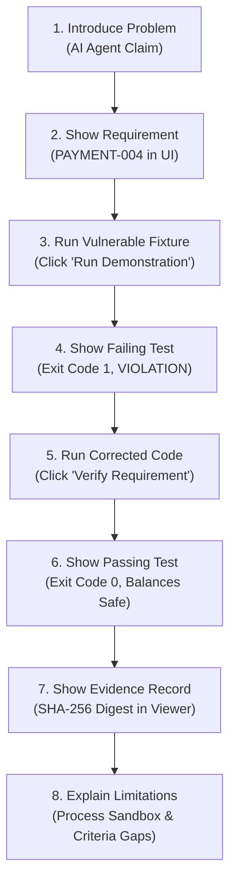

# GHOST PROTOCOL — Three-Minute Live Judging Demo Script

> **Product Tagline**: *"AI says Done. We demand proof."*  
> **Presenter**: Lead Systems Architect  
> **Target Scenario**: `PAYMENT-004` (Overdraft Protection & Atomic Balance Preservation)  
> **Total Duration**: Exactly 3 Minutes (180 Seconds)  

---

## Technical Setup Before Judges Arrive

Ensure the following two terminals are active on the Windows workstation:
1. **Terminal 1 (Backend API Server)**:
   ```powershell
   python -m uvicorn backend.app.main:app --host 127.0.0.1 --port 8000 --reload
   ```
2. **Terminal 2 (Frontend Dashboard)**:
   ```powershell
   cd frontend
   npm run dev
   ```
3. Open browser to **[http://localhost:5173](http://localhost:5173)**.

---

## Structured 8-Step Demonstration Flow



---

### Step 1: Introduce the Problem (0:00 – 0:25)
- **Presenter says**:
  > *"Judges, autonomous AI coding agents are writing massive amounts of code. But every engineering team faces the same critical flaw: completion hallucination. The agent writes code, runs a trivial unit test it wrote for itself, reports 'All tests passed, task complete!', and moves on. But would you trust that claim with your money?"*
- **Action**: Direct attention to the AI agent's false completion claim (`evidence/agent_completion_claim.json`):
  > *"Agent Claim: Implemented money transfer in `backend/app/payment.py`. Test `test_valid_transfer_updates_balances` passed in 0.02s. Requirement PAYMENT-004 is Done!"*
- **The Core Flaw**: The agent only tested transferring ₹200 from an account with ₹10,000 balance. It never tested transferring ₹15,000!

---

### Step 2: Show a Requirement in GHOST PROTOCOL (0:25 – 0:45)
- **Presenter says**:
  > *"Ghost Protocol rejects natural-language claims. We demand executable proof against unambiguous formal specifications."*
- **Action**: In the dashboard, click on **`PAYMENT-004`** in the Requirements Explorer.
- **Show on Screen**:
  - **Specification**: *"When a transfer amount exceeds the sender's available balance, the transfer must be rejected and neither account balance may change."*
  - **Acceptance Criteria**: Point out `AC-04.1` (raises `InsufficientFundsError`), `AC-04.2` (sender balance remains ₹10,000), `AC-04.3` (recipient balance remains ₹0), and `AC-04.4` (atomic immutability).
  - **Bound Test Target**: `backend/tests/test_payment.py::TestPaymentAdversarial::test_overdraft_transfer_rejected_and_balances_unchanged`.

---

### Step 3: Run the Deliberately Vulnerable Payment Implementation (0:45 – 1:05)
- **Presenter says**:
  > *"Let's test what actually happens if we run the agent's code against an adversarial overdraft check."*
- **Action**: Click the top **"Run Demonstration"** button in the dashboard (or run `python scripts/demonstrate_bug.py` in PowerShell).

---

### Step 4: Show the Actual Failing Adversarial Test (1:05 – 1:30)
- **Presenter says**:
  > *"The agent said Done. Here is reality."*
- **Show on Screen**:
  - The vulnerable fixture execution fails immediately with **Exit Code `1`**.
  - **Status**: Transitions to crimson **`VIOLATION`**.
  - **Actual Failure Trace**: `FAILED test_adversarial_vulnerable.py - Failed: DID NOT RAISE InsufficientFundsError`.
  - **Ledger Corruption**: The sender's balance dropped to **-₹5,000** and the recipient balance was credited with **₹15,000**.
  - **Actionable Finding Generated**: `[CRITICAL]` finding `fnd-6f2f3eb6` created with reproduction commands:
    ```powershell
    python -m pytest backend/tests/test_adversarial_vulnerable.py -v
    ```

---

### Step 5: Run the Corrected Implementation (1:30 – 1:50)
- **Presenter says**:
  > *"Now we apply the corrected implementation with atomic balance preservation and re-verify."*
- **Action**: In the Requirements Explorer, click **"Verify Requirement"** on `PAYMENT-004`.

---

### Step 6: Show the Actual Passing Test (1:50 – 2:15)
- **Presenter says**:
  > *"Notice what Ghost Protocol confirms: not just an exit code, but state immutability."*
- **Show on Screen**:
  - **Process Exit Code**: `0` (COMPLETED).
  - **Status**: Transitions to emerald **`VERIFIED`**.
  - **Terminal Output**: `============================== 1 passed in 0.05s ==============================`.
  - **Balance Proof**:
    - Sender balance strictly maintained at **₹10,000**.
    - Recipient balance strictly maintained at **₹0**.
    - Zero phantom mutation.

---

### Step 7: Show the Evidence Record and Verification Verdict (2:15 – 2:40)
- **Presenter says**:
  > *"Every verdict in Ghost Protocol is anchored by immutable cryptographic proof."*
- **Show on Screen**:
  - Direct attention to the **Evidence Viewer** panel:
    - **Evidence ID**: `ev-a42e2660ec` (`PROCESS_LOG`).
    - **SHA-256 Digest**: `52ed69601b9c2098d69f9be5f74dff877c4f41b6cf213a0cc031ae89a14ba24b`.
    - **Code Fingerprint**: Runtime SHA-256 hash of `payment.py` ensuring the code executed is the code in repository.
    - **Tamper Verification**: On-demand integrity endpoint verifies payload against database digest.

---

### Step 8: Explain Remaining Limitations (2:40 – 3:00)
- **Presenter says**:
  > *"To maintain honest engineering, we openly state what Ghost Protocol does and does not do."*
- **Show / Explain**:
  1. **No False Convergence**: Click `PAYMENT-003`—show that because criterion `AC-03.4` has no test, it stays strictly `UNVERIFIED`.
  2. **Process Sandboxing**: Current execution uses isolated OS subprocesses (`shell=False`, 30s timeout, 64KB limits) rather than hardware microVMs.
  3. **Benchmark Proof**: Click **"Benchmark Report"**—show that ordinary tests caught 0/6 defects, while Ghost Protocol caught 6/6 with 0 false alarms.
- **Closing Line**:
  > *"AI says Done. We demand proof. Thank you."*

---

## Standalone CLI Fallback (No Web / Internet Needed)

If presenting in an environment without browser or projector access:
```powershell
# Execute the complete 5-second comparative demonstration
python scripts/demonstrate_bug.py

# Execute the independent 6-defect benchmark harness
python scripts/run_benchmark.py
```
Both commands print full execution scorecards directly to PowerShell with zero dependencies.
