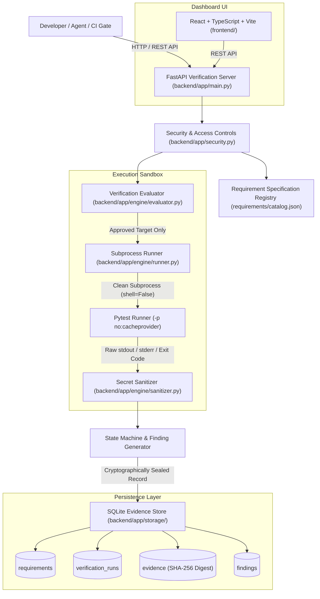
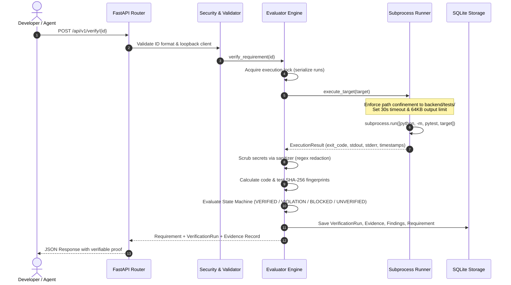

# GHOST PROTOCOL — System Architecture Document

> **Product Slogan**: *"AI says Done. We demand proof."*  
> **Status**: Baseline Architecture (Phase 1)  
> **Author**: Senior Software Architect & Technical Lead  

---

## 1. Executive Summary

Autonomous AI coding agents frequently claim tasks are complete when code merely compiles, or when an agent-written test suite tests only trivial happy paths. **Ghost Protocol** is an independent, zero-trust developer verification tool that replaces unverified completion claims with immutable, reproducible execution evidence.

Ghost Protocol enforces a foundational axiom:  
**Software correctness is a function of executable evidence, not natural language claims.**

---

## 2. Core Architectural Principles

1. **Evidence Before Claims**: No requirement status may be upgraded without a linked `Evidence` artifact originating from an isolated, real execution run.
2. **Four-State Truth Model**:
   - `VERIFIED`: Required checks executed and passed with real execution evidence.
   - `VIOLATION`: Executed evidence demonstrates a requirement failure (assertion failure or behavioral breach).
   - `BLOCKED`: Verification could not complete because of an execution or environment restriction (crash, timeout, missing dependency).
   - `UNVERIFIED`: Sufficient evidence is not available (no test bound, unrun, or criteria gaps).
3. **No False Convergence**: Missing tests yield `UNVERIFIED`, never `VERIFIED`. Blocked executions yield `BLOCKED`, never `VIOLATION`.
4. **Reproducibility & Provenance**: Every `Finding` is paired with exact reproduction instructions and tied to code/test SHA-256 fingerprints.
5. **Zero Trust Subprocess Isolation**: Subprocesses execute strictly predefined, whitelisted targets. No arbitrary shell execution is permitted.

---

## 3. High-Level Component Architecture

---

## 4. Data Flow & Execution Lifecycle

---

## 5. Domain Data Models

### 5.1 Requirement
- `id`: Stable string identifier matching `^[A-Z0-9]+-[A-Z0-9]+$` (e.g., `PAYMENT-004`).
- `title`: Short descriptive title.
- `description`: Formal requirement description.
- `acceptance_criteria`: List of explicit criteria items with `id`, `description`, `linked_test`, and `status`.
- `status`: Current state (`VERIFIED`, `VIOLATION`, `BLOCKED`, `UNVERIFIED`).
- `linked_tests`: Pre-approved executable test targets.

### 5.2 VerificationRun
- `run_id`: Unique identifier formatted as `run-{timestamp}-{uuid}`.
- `requirement_id`: Foreign key linking to the verified requirement.
- `command`: Sanitized command string executed by the engine.
- `execution_status`: Process status (`COMPLETED`, `FAILED`, `BLOCKED`, `TIMEOUT`).
- `exit_code`: Ground-truth operating system exit code.
- `duration_ms`: Wall-clock execution time in milliseconds.
- `summary`: Aggregate counts (total, passed, failed, blocked, unverified).
- `code_fingerprint`: SHA-256 digest of target source code at runtime.
- `test_fingerprint`: SHA-256 digest of test suite at runtime.

### 5.3 Finding
- `finding_id`: Unique identifier (`fnd-{uuid}`).
- `severity`: Severity classification (`CRITICAL`, `HIGH`, `MEDIUM`, `LOW`, `INFO`).
- `requirement_id`: Foreign key linking to the violated requirement.
- `explanation`: Detailed explanation of why the verification check failed.
- `reproduction_instructions`: Exact, deterministic terminal command to reproduce the failure.
- `linked_evidence_ids`: References to the raw execution evidence artifacts.

### 5.4 Evidence
- `evidence_id`: Unique identifier (`ev-{uuid}`).
- `run_id`: Foreign key linking to parent `VerificationRun`.
- `artifact_type`: Nature of payload (`PROCESS_LOG`, `TEST_REPORT`, `TRACE`).
- `source`: Execution provider (e.g. `pytest:TestPaymentAdversarial::test_overdraft`).
- `payload`: Sanitized raw text output (stdout and stderr).
- `integrity_metadata`: SHA-256 cryptographic digest of payload and exit code.

---

## 6. API Boundaries

All API endpoints reside under `/api/v1/` with strong type validation and dependency injection:

| Method | Route | Description | Auth / Access |
| :--- | :--- | :--- | :--- |
| `GET` | `/health` | Basic service operational check | Public loopback |
| `GET` | `/api/v1/health` | Service health and catalog telemetry | Public loopback |
| `GET` | `/api/v1/requirements` | List requirements with verified status | Public loopback |
| `GET` | `/api/v1/requirements/{id}` | Retrieve specific requirement details | Public loopback |
| `POST`| `/api/v1/verify/{id}` | Execute verification run for requirement | Loopback + Auth |
| `POST`| `/api/v1/verify-all` | Sequential verification across catalog | Loopback + Auth |
| `GET` | `/api/v1/runs` | List verification run history | Public loopback |
| `GET` | `/api/v1/runs/{run_id}` | Retrieve run details and exit code | Public loopback |
| `GET` | `/api/v1/evidence/{evidence_id}` | Retrieve immutable evidence artifact | Public loopback |
| `GET` | `/api/v1/evidence/{id}/verify` | Cryptographically verify evidence seal | Public loopback |
| `GET` | `/api/v1/findings` | Query discovered defect findings | Public loopback |
| `GET` | `/api/v1/coverage` | Acceptance criteria coverage analysis | Public loopback |
| `POST`| `/api/v1/demonstrate/...` | Run comparative vulnerable vs corrected demo | Loopback + Auth |
| `POST`| `/api/v1/benchmark/run` | Execute independent benchmark harness | Loopback + Auth |

---

## 7. Security Considerations

1. **No Arbitrary Command Execution**: Test targets are validated against an allowlist and strict path confinement (`backend/tests/`). User-supplied arbitrary shell strings are never passed to the system shell (`shell=False`).
2. **Flag Injection Prevention**: Arguments beginning with `-` (e.g., `-o`, `--override-ini`) are rejected to prevent hijacking pytest configuration.
3. **Path Traversal Confinement**: All targets are resolved to absolute paths and verified to reside inside `backend/tests/` via `resolved.relative_to(tests_dir)`.
4. **Secret Scrubbing**: Raw subprocess output is passed through regex sanitization masking API keys (OpenAI, Anthropic, Gemini), AWS tokens, GitHub credentials, and private keys prior to persistence.
5. **Local Loopback Enforcement**: State-modifying endpoints verify client origin to prevent unauthorized cross-origin execution from external networks.
6. **Execution Boundedness**: Subprocesses are bounded by a 30-second timeout and 64KB UTF-8 byte output limits to prevent denial-of-service memory exhaustion.
