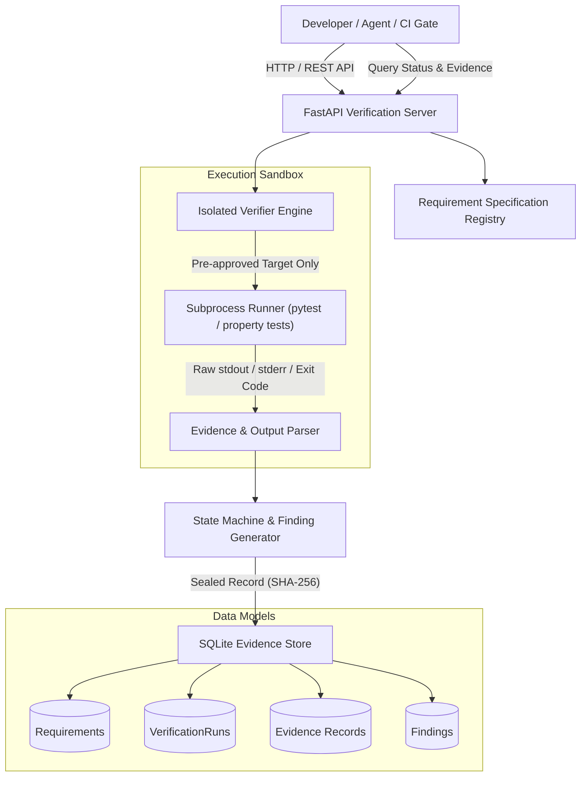
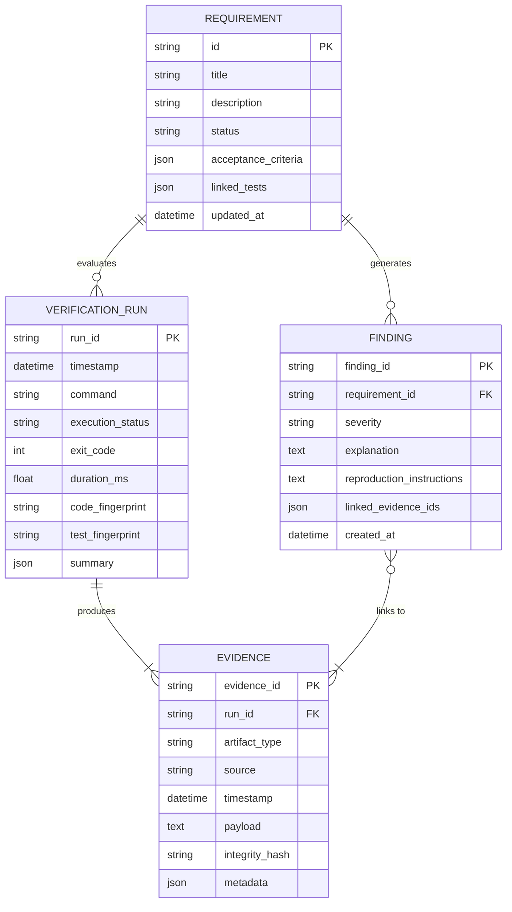

# Project Ghost Protocol — System Architecture Document

> **Product Slogan**: *"AI says Done. We demand proof."*  
> **Status**: Foundation Architecture (Phase 0)  
> **Author**: Principal Software Architect & Technical Lead  

---

## 1. Executive Summary

Autonomous coding agents (LLMs) frequently claim tasks are complete when code merely compiles, tests are mocked to pass trivial assertions, or critical adversarial edge-cases are completely ignored. **Ghost Protocol** is an independent, zero-trust developer verification tool that replaces unverified completion claims with immutable, reproducible execution evidence.

Ghost Protocol enforces a foundational axiom: **Software correctness is a function of executable evidence, not natural language claims.**

---

## 2. Core Architectural Principles

1. **Evidence Before Claims**: No requirement status may be asserted or upgraded without a linked `Evidence` artifact originating from an isolated, real execution run.
2. **Four-State Truth Model**:
   - `VERIFIED`: Required checks executed and passed with cryptographic evidence.
   - `VIOLATION`: Executed checks demonstrate a requirement failure (assertion failure or behavioral breach).
   - `BLOCKED`: Execution aborted due to dependency failure, syntax error, environment fault, or safety cutoff.
   - `UNVERIFIED`: Insufficient or missing evidence; no test run exists or no tests were collected.
3. **No False Convergence**: Missing tests yield `UNVERIFIED`, never `VERIFIED`. Blocked executions yield `BLOCKED`, never `VIOLATION`.
4. **Reproducibility & Provenance**: Every `Finding` is paired with exact reproduction instructions and tied to code/test SHA-256 fingerprints.
5. **Zero Trust Subprocess Isolation**: Subprocesses execute strictly predefined, whitelisted targets. No arbitrary shell execution is permitted.

---

## 3. High-Level Component Architecture

---

## 4. Domain Data Models

### 4.1 Requirement
Represents an approved functional or non-functional software requirement.
- `id`: Stable string identifier (e.g., `PAYMENT-004`).
- `title`: Short descriptive title.
- `description`: Detailed technical requirement specification.
- `acceptance_criteria`: List of explicit criteria items.
- `status`: Current evaluated state (`VERIFIED`, `VIOLATION`, `BLOCKED`, `UNVERIFIED`).
- `linked_tests`: Whitelist of executable test paths bound to this requirement.
- `created_at` / `updated_at`: ISO-8601 UTC timestamps.

### 4.2 VerificationRun
Represents an actual execution session of a test suite or verification harness.
- `run_id`: Unique identifier (e.g., `run-20261114-1234abcd`).
- `timestamp`: Execution initiation timestamp (UTC).
- `command`: Sanitized command string executed by the engine.
- `execution_status`: Process status (`COMPLETED`, `FAILED`, `BLOCKED`, `TIMEOUT`).
- `exit_code`: Real process exit status code.
- `duration_ms`: Execution wall-clock elapsed time in milliseconds.
- `summary`: Aggregate metrics (total tests, passed, failed, blocked, unverified).
- `code_fingerprint`: SHA-256 hash of target source files.
- `test_fingerprint`: SHA-256 hash of test suite files.

### 4.3 Finding
Actionable defect or compliance violation discovered during a verification run.
- `finding_id`: Unique identifier (e.g., `fnd-abc123`).
- `severity`: Finding severity (`CRITICAL`, `HIGH`, `MEDIUM`, `LOW`, `INFO`).
- `requirement_id`: Foreign key linking to the violated requirement.
- `explanation`: Detailed technical explanation of why the check failed.
- `reproduction_instructions`: Exact, deterministic terminal command to reproduce the failure.
- `linked_evidence_ids`: References to the raw execution evidence artifacts.

### 4.4 Evidence
Immutable audit artifact capturing ground-truth execution output.
- `evidence_id`: Unique identifier (e.g., `ev-xyz789`).
- `artifact_type`: Nature of payload (`PROCESS_LOG`, `TEST_REPORT`, `TRACE`, `CODE_DIFF`).
- `source`: Execution provider (e.g., `pytest:TestPaymentAdversarial::test_overdraft`).
- `timestamp`: Capture timestamp (UTC).
- `run_id`: Foreign key linking to the parent `VerificationRun`.
- `payload`: Raw text output (stdout, stderr, traceback, assertion difference).
- `integrity_metadata`: SHA-256 digest of payload, environment data, exit code.

---

## 5. Persistence Strategy (SQLite)

Ghost Protocol utilizes local SQLite for zero-configuration, deterministic local development, structured with foreign key relational integrity:

---

## 6. Threat Model & Security Boundaries

1. **Host Defense (No Remote Shell Execution)**: The API accepts only validated requirement IDs. The execution command is constructed strictly from internal configuration maps.
2. **Path Traversal Prevention**: Evidence storage paths are strictly canonicalized and asserted to remain inside the project root (`base_dir.resolve() in target.resolve().parents`).
3. **Execution Timeouts**: All subprocesses are bounded by strict wall-clock timeouts (default: 30 seconds) to prevent infinite loops, deadlocks, or fork bombs.
4. **Environment Isolation**: Subprocesses receive a clean, filtered environment dictionary stripping API keys, cloud tokens, and sensitive system credentials.
