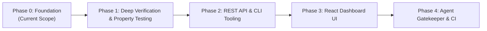

# Project Ghost Protocol — Phased Implementation Plan

> **Mission**: Build an independent verification tool replacing AI claims with executable evidence.  
> **Status**: Approved Blueprint  

---

## 1. Phased Roadmap Checklist

---

### Phase 0: Foundation Phase (Current Execution Target)
- [x] **Repository Initialization & Version Control**: Git repository with rigorous `.gitignore`.
- [x] **Architectural Blueprint & Security Specifications**: `docs/architecture.md`, `docs/implementation_plan.md`, `docs/api_contracts.md`, `docs/security_and_testing_strategy.md`.
- [x] **Canonical Domain Models (Pydantic v2)**:
  - `VerificationStatus`: `VERIFIED`, `VIOLATION`, `BLOCKED`, `UNVERIFIED`.
  - `Requirement`: stable ID, acceptance criteria, status, linked tests.
  - `VerificationRun`: run ID, execution status, process exit code, duration, summary metrics.
  - `Finding`: severity, requirement ID, explanation, reproduction instructions, linked evidence IDs.
  - `Evidence`: artifact type, source, timestamp, run ID, payload, cryptographic integrity metadata.
- [x] **Relational SQLite Persistence Layer**:
  - Schema with foreign keys, transactional queries, and serialization helpers in `backend/app/storage/`.
- [x] **Requirements Catalog Specification**:
  - Centralized catalog in `requirements/catalog.json` and `requirements/` specs.
- [x] **Subprocess Runner & Evidence Pipeline**:
  - Secure test runner executing approved pytest targets and generating sealed evidence and findings.
- [x] **Property-Based Invariant Verification**:
  - Financial domain invariant tests (non-negative balances, balance conservation, idempotency).
- [x] **Frontend Foundation Manifest**:
  - Frontend directory scaffold (`frontend/package.json`, Vite configuration, TypeScript types).
- [x] **Baseline Verification**:
  - 100% test pass rate across unit, property, and verifier test suites.

---

### Phase 1: Deep Verification Engine & Sandbox Isolation
- [ ] Process memory limits and CPU cgroup/resource throttling.
- [ ] Static AST analysis to detect mock injection or assertion bypasses.
- [ ] Diff analysis comparing pre-run vs post-run repository state.
- [ ] Concurrency and race-condition stress-testing harness.

---

### Phase 2: REST API Expansion & CLI Tooling
- [ ] Full FastAPI CRUD and execution endpoints for Requirements, VerificationRuns, Findings, and Evidence.
- [ ] `ghost` standalone CLI tool:
  - `ghost verify <REQ_ID>`
  - `ghost verify --all`
  - `ghost audit <RUN_ID>`
  - `ghost findings --severity=critical`
- [ ] Streaming real-time execution logs via Server-Sent Events (SSE).

---

### Phase 3: Interactive Dashboard (React + TypeScript + Vite + Tailwind)
- [ ] Real-time verification matrix dashboard.
- [ ] Cryptographic Evidence viewer with syntax-highlighted stdout/stderr traces.
- [ ] Finding inspector with one-click reproduction commands.
- [ ] Audit report export (JSON/PDF).

---

### Phase 4: Agent Gatekeeper & CI/CD Integration
- [ ] GitHub Action / Git pre-push hook blocking commits without cryptographic proof.
- [ ] MCP (Model Context Protocol) tool integration for direct agent compliance checks.
- [ ] Tamper-evident verification badge generation for repository READMEs.
